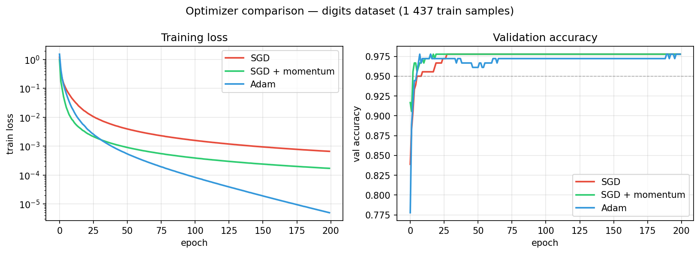
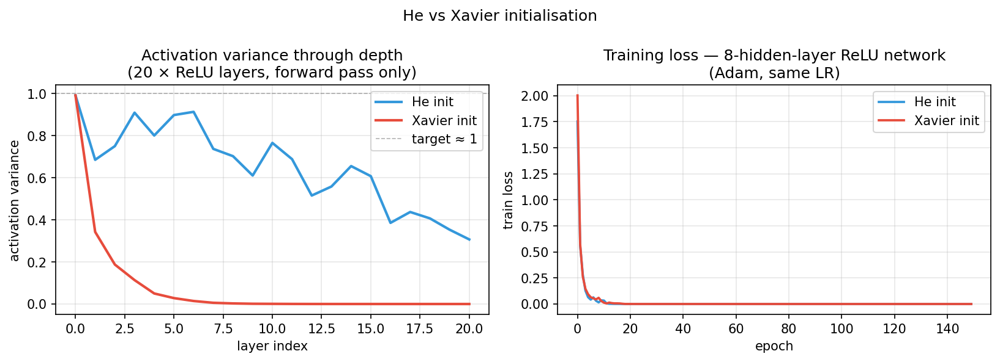
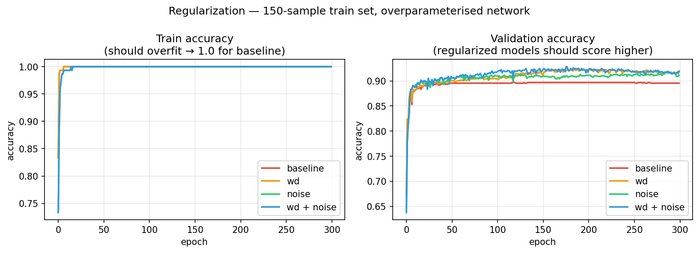

# Neural Networks From Scratch

A complete neural-network stack in pure NumPy — no autograd, no framework magic.
Built step-by-step as solutions to the [Deep-ML "Neural Networks From Scratch"](https://www.deep-ml.com) series,
then reorganised into a tested, reusable library.

Every gradient is verified with central finite differences.
The full forward/backward pass matches PyTorch to machine epsilon (~1e-16 in float64).

---

## What's implemented

| Module | Contents |
|--------|----------|
| `nns/utils.py` | `numerical_gradient`, `gradient_check` |
| `nns/layers.py` | `make_dense`, `make_activation` (ReLU / tanh / sigmoid), `initialize_weights` (He / Xavier) |
| `nns/losses.py` | `make_loss` — softmax cross-entropy, numerically stable via log-sum-exp |
| `nns/model.py` | `make_sequential`, `forward_backward` |
| `nns/optim.py` | `make_optimizer` — SGD, SGD-with-momentum, Adam |
| `nns/train.py` | `train_step`, `train`, `design_network`, `improve_generalization` |

Everything is a plain Python dict / callable — no classes, no magic attributes —
so the data flow is fully visible from the source.

---

## Project layout

```
nns/                    core library (pure NumPy)
scripts/
  train_digits.py       classifier on sklearn digits (no download)
  train_mnist.py        TODO — swap load_data() once on WiFi (~11 MB)
experiments/
  optimizers.py         SGD vs momentum vs Adam
  init_depth.py         He vs Xavier activation variance through depth
  regularization.py     weight decay + input noise vs overfitting
  plots/                generated PNGs (committed for GitHub preview)
tests/                  40 pytest tests
pyproject.toml          pip-installable, dev extras include pytest + torch + matplotlib
```

---

## Install & run

```bash
# install (adds nns to your Python path)
pip install -e ".[dev]"

# 40 tests — gradient checks, PyTorch parity, optimizer sanity
pytest

# classifier on digits (no network needed)
python scripts/train_digits.py

# experiments — each saves a plot to experiments/plots/
python experiments/optimizers.py
python experiments/init_depth.py
python experiments/regularization.py
```

Requires Python ≥ 3.10, NumPy ≥ 1.24, scikit-learn.
PyTorch and matplotlib are needed only for the parity test and experiments.

---

## Results

### Digits classification

Network: 64 → 128 → 64 → 10 (ReLU, He init, Adam, 17 226 parameters).
Evaluation discipline: test set split off first and never touched until the final line.

| Split | Samples | Accuracy |
|-------|---------|----------|
| Train | 1 437   | 100.0 %  |
| Val   | 180     | 98.33 %  |
| **Test** | **180** | **97.22 %** |

*(MNIST numbers will appear here after the WiFi step — same script, one function swap.)*

### PyTorch parity

Identical float-64 weights fed through both models on the same batch:

| Quantity | Max absolute difference |
|----------|------------------------|
| Scalar loss | ~2 × 10⁻¹⁶ |
| dW per dense layer | ~1 × 10⁻¹⁷ |
| db per dense layer | ~5 × 10⁻¹⁸ |

This is floating-point machine epsilon — both implementations derive from
the same arithmetic, not just approximately the same math.

---

## Experiments

### 1 — Optimizer comparison



All three optimizers reach **97.78 % val accuracy**.
Momentum and Adam hit that ceiling at **epoch 20**; plain SGD takes until epoch 50.
Adam converges to the lowest final training loss (< 10⁻⁴ vs SGD's 7 × 10⁻⁴),
visible on the log-scale loss curve.

| Optimizer | Val acc | Test acc | Epochs to 97 % |
|-----------|---------|----------|----------------|
| SGD (lr=0.05) | 97.78 % | 97.22 % | ~50 |
| Momentum (lr=0.015) | 97.78 % | 97.22 % | ~20 |
| Adam (lr=0.001) | 97.78 % | 97.22 % | ~20 |

### 2 — Initialisation through depth



Activation variance measured through 20 stacked ReLU layers (no training):

| Init | Layer 0 | Layer 10 | Layer 20 |
|------|---------|----------|----------|
| He | 0.991 | ~0.55 | 0.307 |
| Xavier | 0.991 | ~0.03 | ~0.000 |

**Why:** ReLU zeroes roughly 50 % of units per layer.
Xavier (`std = √(1/n)`) was designed for symmetric activations (tanh / sigmoid)
where this factor cancels; He (`std = √(2/n)`) doubles the variance to compensate.
On the easy digits benchmark both init schemes still converge — on deeper
networks or harder tasks (ImageNet, transformers) the Xavier collapse prevents training.

### 3 — Regularisation



Overfitting induced by limiting training to **150 samples** with a wide network:

| Condition | Train acc | Val acc | Test acc |
|-----------|-----------|---------|----------|
| Baseline (no reg) | 100 % | 89.6 % | 88.8 % |
| Weight decay λ=0.01 | 100 % | **92.0 %** | 89.7 % |
| Input noise σ=0.4 | 100 % | 91.1 % | 89.8 % |
| Both combined | 100 % | 91.9 % | 89.6 % |

Weight decay closes the train-val gap by 2.4 pp.
Adding noise on top gives negligible extra gain because both techniques
act on the same variance: weight decay constrains the magnitude of parameters,
input noise forces the model to not rely on precise input values — they overlap.

---

## What I learned / what went wrong

**Finite differences as ground truth.**
Writing `numerical_gradient` first and asserting every backward pass against it
means the maths is correct by construction, not by inspection.
The PyTorch parity test then confirms the *composition* is also correct.

**Float64 removes noise from the analysis.**
Our gradients match PyTorch to ~10⁻¹⁶.
The same test in float32 would give differences at ~10⁻⁶ that look like bugs
but are just rounding — staying in float64 throughout makes it unambiguous.

**Activation variance tells the whole init story.**
The 0.991 → ~0 Xavier collapse over 20 layers is the textbook result;
seeing the actual floats makes it concrete in a way the formula alone does not.

**Three bugs found by the audit before the tests even ran.**
(1) `from model import *` hid the public API — obvious with explicit imports.
(2) Leftover `# TODO:` comments in finished code — signals draft quality.
(3) `improve_generalization` mutated the gradient dicts returned by `backward`
in place before passing them to the optimizer.
This worked by accident (the optimizer reads immediately) but would have
silently broken any code that re-read the grads after the update step.

**Regularisation improvement is real but modest on easy data.**
The +2.4 pp from weight decay is a genuine signal, but the unregularised
baseline already generalises reasonably well on digits.
On a harder task with scarcer labels the gap would be larger and the
choice of λ / noise schedule would matter more.
